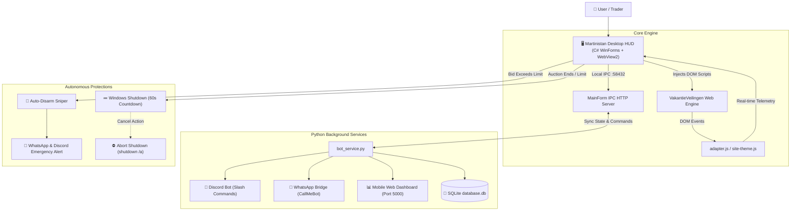

# 🦝 Martinistan Vavabid Sniper Suite v2.0
### Autonomous Multi-Tab Auction Sniper & Management Gateway for VakantieVeilingen
**Architected & Developed by [martinistan](https://github.com/martinistan)**

[](https://microsoft.com)
[](https://github.com/martinistan/vavabid)
[](https://github.com/martinistan/vavabid)
[](README.md)
[](LICENSE)

---

## 🌐 Language Navigation / Taal Navigatie / Dil Seçimi
- [🇬🇧 English](#-english-default)
- [🇳🇱 Nederlands](#-nederlands)
- [🇹🇷 Türkçe](#-türkçe)
- [📂 Project Structure & Architecture](#-project-structure--architecture)
- [⚖️ Attribution & Heritage](#️-open-source-heritage--attribution)

---

## 🇬🇧 English (Default)

**Martinistan Vavabid Sniper Suite** is a high-frequency, sub-second precision auction sniper and remote automation platform engineered for `vakantieveilingen.nl` and `vakantieveilingen.be`.

### Key Features
- 🎯 **Sub-Second Precision Sniper**: Submits automated +1 € increment bids at the targeted countdown second (default: 1 second).
- 🌐 **Modern Chrome-Style HUD**: Back (`←`), Forward (`→`), Reload (`⟳`), `F5` / `Ctrl+R` hotkeys, and capsule Omnibox URL bar (`🔒`).
- 🛑 **Limit Exceed Protection & Auto-Disarm**: If auction price reaches or exceeds your configured ceiling (default: 32 €), the sniper disarms automatically (`page.Armed = false`) and triggers instant Discord and WhatsApp alerts.
- 💤 **Autonomous PC Shutdown**: Configurable 60-second abortable countdown (`shutdown.exe /s /t 60`) on auction completion or limit breach with one-click cancel (`shutdown.exe /a`).
- 🤖 **Discord Bot Gateway**: Real-time slash commands (`/ihale`, `/limit`, `/durdur`, `/kapat_iptal`), telemetry embeds, and screenshot uploads.
- 📱 **Direct WhatsApp Push**: Native CallMeBot bridge alerting you instantly when an auction is won or a limit is exceeded.
- 📊 **Mobile Web Dashboard**: OLED black web panel served on port 5000 for monitoring and adjusting limits from mobile devices.
- 📦 **One-Click Deployment**: Self-contained installer `Umutistan_Tek_Tikla_Kurulum.exe` that safely deploys dependencies to `C:\VakantieVeilingenBot\` while preserving user databases and configs.

---

## 🇳🇱 Nederlands

**Martinistan Vavabid Sniper Suite** is een hoogfrequente veiling-sniper en beheersoftware ontworpen voor `vakantieveilingen.nl`.

### Belangrijkste Functies
- 🎯 **Milliseconde Precisie Sniper**: Automatisch bieden met +1 € verhoging op het gewenste aftelmoment (standaard: 1 seconde voor sluiting).
- 🌐 **Moderne Chrome Navigatie**: Terug (`←`), Vooruit (`→`), Vernieuwen (`⟳`), `F5` / `Ctrl+R` sneltoetsen en beveiligde Omnibox adresbalk (`🔒`).
- 🛑 **Limietbeveiliging & Auto-Disarm**: Als het bod uw maximum bereikt (standaard: 32 €), schakelt de bot automatisch uit en verzendt waarschuwingen via Discord en WhatsApp.
- 💤 **Automatische PC Afsluiting**: Configureerbare 60-seconden aftelling (`shutdown.exe /s /t 60`) na afloop of limiet met annuleerknop (`shutdown.exe /a`).
- 🤖 **Discord Bot Integratie**: Slash commands voor beheer op afstand, statuskaarten en screenshots.
- 📱 **WhatsApp Meldingen**: Directe notificaties via de CallMeBot API bij winst of limietwaarschuwing.
- 📊 **Mobiel Webpaneel**: Toegankelijk via poort 5000 op uw smartphone binnen hetzelfde netwerk.

---

## 🇹🇷 Türkçe

**Martinistan Vavabid Sniper Suite**, [VakantieVeilingen](https://www.vakantieveilingen.nl) açık artırmaları için geliştirilmiş yüksek frekanslı, çok sekmeli otonom ihale takip ve son saniye teklif motorudur.

### Temel Özellikler
- 🎯 **Milisaniye Hassasiyetli Sniper**: İhale bitimine 1 saniye kala otomatik +1 € artırımlı teklif basar.
- 🌐 **Chrome Tarzı Arayüz**: Geri (`←`), İleri (`→`), Yenile (`⟳`), `F5` / `Ctrl+R` kısayolları ve kapsül Omnibox adres çubuğu (`🔒`).
- 🛑 **Limit Aşımı Koruması**: İhale fiyatı belirlediğiniz limiti (varsayılan: 32 €) aşarsa anında teklif vermeyi keser (`Auto-Disarm`) ve Discord/WhatsApp uyarısı gönderir.
- 💤 **Otonom PC Kapatma**: İhale bittiğinde veya limit aşıldığında bilgisayarı 60 saniyelik geri sayımla kapatır; tek tıkla iptal edilebilir.
- 🤖 **Discord & WhatsApp Entegrasyonu**: Slash komutları ile uzaktan yönetim ve telefona anlık WhatsApp bildirimi.
- 📊 **Mobil Web Kontrol Paneli**: Port 5000 üzerinden telefon tarayıcınızdan canlı takip ve limit güncelleme.

---

## 📂 Project Structure & Architecture

### 🗂️ Clean Modular Directory Layout
```
martinistan-vavabid/
├── src/
│   ├── frontend/            # HTML5, CSS3, JS WebView2 HUD Panels
│   │   ├── sidebar-ui.html  # Sniper controls, Stepper inputs, Chrome Omnibox
│   │   ├── topbar-ui.html   # Chrome tabs strip, navigation buttons
│   │   ├── settings-ui.html # Settings panel (Tokens, PIN, Defaults)
│   │   ├── dialog-ui.html   # Sleek dark confirmation modal
│   │   ├── terminal-ui.html # Real-time log stream
│   │   ├── ui-theme.css     # Luxury cyber dark theme styling
│   │   ├── site-dark.css    # Injected web dark mode stylesheet
│   │   ├── site-theme.js    # Injected web layout adapter
│   │   ├── adapter.js       # Injected countdown & bidding bridge
│   │   └── brand-mark.svg   # Vector application logo
│   │
│   ├── backend/             # Python Microservices & External Gateways
│   │   ├── bot_service.py   # Multi-threaded background service runner
│   │   ├── discord_bot.py   # Discord slash commands & screenshot gateway
│   │   ├── web_dashboard.py # Flask/aiohttp mobile web control panel (Port 5000)
│   │   ├── db_manager.py    # SQLite database management layer
│   │   └── whatsapp_assistant.py # CallMeBot WhatsApp push integration
│   │
│   ├── desktop/             # C# WinForms .NET 4.8 Core Host
│   │   ├── MainForm.cs      # Core window, WebView2 manager, IPC server (:58432)
│   │   ├── Program.cs       # Application entry point & single-instance lock
│   │   ├── UmutistanBieder.csproj # Visual Studio project definition
│   │   └── app.manifest     # Per-Monitor V2 DPI & Windows 10/11 manifest
│   │
│   └── installer/           # One-Click Setup Assistant
│       ├── InstallerApp.cs  # C# Standalone wizard with embedded payload.zip
│       └── single_installer_runner.py # Legacy fallback builder
│
├── releases/                # Official Standalone Packages & Binaries
│   ├── Umutistan_Tek_Tikla_Kurulum.exe # Standalone setup executable
│   ├── Umutistan_v2.0_Installer_Bundle.zip # Full archive
│   └── Umutistan_v2.0_Portable_Payload.zip # Portable runtime assets
│
├── docs/                    # Extended Documentation & AI Instructions
│   ├── README.AI.md         # Comprehensive AI Agent & LLM architectural guide
│   └── KULLANIM_KILAVUZU.md # Turkish operational manual
│
├── GITHUB_A_YUKLE.bat       # Indestructible one-click GitHub push launcher
├── push_to_github.ps1       # Interactive resilient PowerShell upload helper
├── settings.example.json    # Safe template configuration file
└── README.md                # Master Multilingual Documentation
```

---

### 🏗️ System Architecture Diagram



---

## 🛠️ Build & Compilation

Targeting .NET Framework 4.8 (`csc.exe` v4.0.30319, C# 5 syntax):

```cmd
:: 1. Compile Main Desktop Binary:
C:\Windows\Microsoft.NET\Framework64\v4.0.30319\csc.exe /nologo /target:winexe /win32icon:app-logo.ico /win32manifest:app.manifest /out:UmutistanDolandiricilikHizmetleri.exe /r:System.dll,System.Core.dll,System.Drawing.dll,System.Windows.Forms.dll,System.Web.Extensions.dll,Microsoft.Web.WebView2.Core.dll,Microsoft.Web.WebView2.WinForms.dll Program.cs MainForm.cs

:: 2. Compile Standalone One-Click Installer:
C:\Windows\Microsoft.NET\Framework64\v4.0.30319\csc.exe /nologo /target:winexe /win32icon:app-logo.ico /resource:payload.zip /out:Umutistan_Tek_Tikla_Kurulum.exe /r:System.dll,System.Core.dll,System.Drawing.dll,System.Windows.Forms.dll,System.Web.Extensions.dll,System.IO.Compression.dll,System.IO.Compression.FileSystem.dll InstallerApp.cs
```

---

## ⚖️ Open Source Heritage & Attribution

This project was originally inspired by and adapted from the legacy open-source repository [Soneritics/VakantieVeilingenBieder](https://github.com/Soneritics/VakantieVeilingenBieder).

It has been completely rebuilt, modernized, and extended with the assistance of Artificial Intelligence (AI) to introduce a Chromium-based Microsoft WebView2 architecture, multi-tab sniper engine, modern Chrome UI, Python Discord/WhatsApp microservices, and autonomous safety protections.

*Authored and maintained by **martinistan** (@martinistan).*
